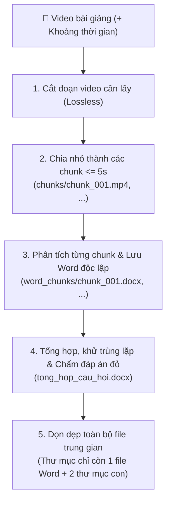

# 🎓 azotaFromVideo — Trích Xuất Đề Thi Trắc Nghiệm Từ Video Bài Giảng

> **Skill thông minh dành cho AI Agent (Antigravity):** Tự động bóc tách đề trắc nghiệm, hình ảnh minh họa, bảng biểu và đáp án từ video bài giảng bằng phương pháp chia nhỏ vi mô — loại bỏ hoàn toàn hiện tượng quá tải bộ nhớ và hallucination (ảo giác/bịa câu hỏi), tự động xuất file Word chuẩn format và dọn dẹp sạch sẽ.

---

## 🚀 Hướng Dẫn Cài Đặt (Quick Start)

> [!IMPORTANT]
> **Cách cài đặt nhanh nhất bằng AI Agent:**
> 1. Tải file **`azotaFromVideo.zip`** về máy tính của bạn.
> 2. **Giải nén** file `azotaFromVideo.zip`.
> 3. Mở khung chat với **Agent (Antigravity)** trong thư mục dự án và gửi tin nhắn yêu cầu Agent cài đặt:
>    ```text
>    "Hãy cài đặt skill azotaFromVideo này giúp tôi"
>    ```
>    *(Agent sẽ tự động nhận diện file `SKILL.md` và tích hợp skill vào hệ thống của bạn ngay lập tức mà bạn không cần cấu hình thủ công).*

<details>
<summary><b>🛠️ Dành cho người muốn cài đặt thủ công (Click để mở rộng)</b></summary>

### Cách 1: Thiết lập cho riêng Dự án / Thư mục làm việc (Workspace Skill)
Copy thư mục `azotaFromVideo` vào thư mục dự án theo cấu trúc:
```text
your-project/
└── .agents/
    └── skills/
        └── azotaFromVideo/
            ├── SKILL.md
            ├── TOOL.md
            ├── README.md
            └── scripts/
```

### Cách 2: Thiết lập Toàn hệ thống (Global Skill)
Để có thể gọi lệnh `/azotaFromVideo` ở bất kỳ thư mục nào trên máy tính, copy toàn bộ thư mục `azotaFromVideo` vào:
- **Windows:** `C:\Users\<Tên_User>\.gemini\config\skills\azotaFromVideo\`
- **Linux / macOS:** `~/.gemini/config/skills/azotaFromVideo/`

### Cài đặt thư viện phụ trợ:
Đảm bảo máy tính đã cài đặt Python (>= 3.9) và cài đặt 2 thư viện hỗ trợ (không cần cài riêng FFmpeg vì đã được tích hợp sẵn qua gói `imageio-ffmpeg`):
```bash
py -m pip install imageio-ffmpeg python-docx
```
</details>

---

## 🌟 Điểm Nổi Bật & Tính Năng Vượt Trội

- ⚡ **Cắt video siêu tốc (Lossless):** Sử dụng FFmpeg stream copy (`-c copy`) để trích xuất đoạn video cần lấy trong tích tắc, bảo toàn 100% độ sắc nét của chữ và hình ảnh trên slide.
- 🧩 **Chiến lược Micro-Chunking (5 giây/đoạn):** Chia nhỏ video bài giảng thành các đoạn vi mô, ép keyframe chuẩn xác. Mỗi đoạn chỉ chứa từ 1 đến 5 câu hỏi -> **Chống tràn ngữ cảnh và triệt tiêu 100% hiện tượng AI bị ảo giác / bịa nội dung**.
- 🖼️ **Bóc tách ghi chú & hình ảnh minh họa đầy đủ:** Tự động nhận diện các thông tin phụ phục vụ trả lời câu hỏi (hình ảnh minh họa, sơ đồ, biểu đồ, đoạn code, dữ liệu đề bài) và nhúng trực tiếp dưới câu hỏi trong file Word.
- 🎯 **Đáp án chuẩn & format chuyên nghiệp:** Nhận diện ký hiệu đánh dấu, màu sắc đáp án đúng hoặc vùng Speaker Notes -> Tự động tô chữ **màu đỏ** và **in đậm** cho đáp án đúng.
- 🧹 **Khử trùng lặp & Dọn dẹp tự động triệt để:** 
  - Khử trùng lặp thông minh giữa các slide ở ranh giới 5s hoặc slide lặp lại trong video.
  - Tự động xoá sạch mọi file rác, video cắt tạm và script trung gian. Thư mục chính chỉ giữ lại duy nhất 1 file Word hoàn chỉnh và 2 thư mục con được sắp xếp ngăn nắp.

---

## 🔄 Quy Trình Xử Lý Chuẩn 5 Bước



---

## 💻 Hướng Dẫn Sử Dụng

### Cách 1: Sử dụng Slash Command trong khung chat AI (Khuyên dùng)
Chỉ cần nhập lệnh bắt đầu bằng `/azotaFromVideo` kèm mốc thời gian và tên video:

```text
/azotaFromVideo 1p14
```
hoặc:
```text
/azotaFromVideo từ 00:00:00 đến 00:02:15 video BaiGiang_Chuong1.mp4
```
hoặc:
```text
/azotaFromVideo 0s đến 74s
```

Agent sẽ tự động thực hiện toàn bộ quy trình từ cắt video, chia chunk, trích xuất hình ảnh câu hỏi đến tạo file Word hoàn chỉnh.

### Cách 2: Gọi Tool Trực Tiếp Bằng CLI (Dành cho Developer)
Bạn có thể tự chạy từng bước hoặc chạy toàn bộ pipeline tự động:

```bash
# Chạy toàn bộ quy trình liên hoàn tự động
py scripts/pipeline.py -s 00:00:00 -e 1p14 -i BaiGiang.mp4

# Hoặc chạy từng tool riêng biệt:
py scripts/cut_video.py -s 00:00:00 -e 1p14 -i BaiGiang.mp4
py scripts/split_chunks.py -i BaiGiang_cut.mp4 -d 5 -o chunks
py scripts/generate_word.py -i extracted_questions.json -o tong_hop_cau_hoi.docx
```
*(Xem hướng dẫn chi tiết các tham số tại TOOL.md)*

---

## 📁 Cấu Trúc Kết Quả Sau Khi Hoàn Thành

Sau khi xử lý xong, hệ thống tự động dọn dẹp tất cả các file rác trung gian. Thư mục làm việc của bạn sẽ vô cùng gọn gàng:

```text
📁 Thu_Muc_Lam_Viec/
├── 📁 chunks/                         # Thư mục con chứa các video chunks <= 5s
│   ├── chunk_001.mp4
│   ├── chunk_002.mp4
│   └── ...
├── 📁 word_chunks/                    # Thư mục con chứa file Word bóc tách theo từng chunk
│   ├── chunk_001.docx
│   ├── chunk_002.docx
│   └── ...
└── 📄 tong_hop_cau_hoi.docx           # File Word TỔNG HỢP DUY NHẤT chuẩn format tại thư mục chính
```

---

## 📝 Quy Chuẩn Định Dạng File Word Đầu Ra

File Word được thiết kế tương thích hoàn hảo để import vào hệ thống thi trực tuyến (như Azota, Quizizz, Google Forms...):

```text
Câu 1: Cho đoạn mã sau, giá trị in ra màn hình là bao nhiêu?
[Hình ảnh minh họa sơ đồ / đoạn code được chèn trực tiếp tại đây]
A. 10
B. 20 (chữ màu đỏ, in đậm)
C. 30
D. 40

Câu 2: Đâu là đặc điểm chính của mô hình kiến trúc Client-Server?
A. Phân chia vai trò rõ ràng giữa bên yêu cầu và bên phục vụ (chữ màu đỏ, in đậm)
B. Không cần máy chủ trung tâm
C. Mọi máy trạm đều có quyền hạn ngang nhau
D. Không hỗ trợ giao thức TCP/IP
```

---

## 📂 Cấu Trúc Mã Nguồn Dự Án

```text
azotaFromVideo/
├── SKILL.md            # Chỉ dẫn Prompt hệ thống & quy tắc chuẩn cho AI Agent
├── README.md           # Tài liệu hướng dẫn sử dụng & giới thiệu dự án
├── TOOL.md             # Sổ tay chi tiết hướng dẫn các script dòng lệnh
└── scripts/            # Bộ mã nguồn thực thi
    ├── cut_video.py         # Cắt video siêu tốc không suy giảm chất lượng (Lossless)
    ├── split_chunks.py      # Chia nhỏ video thành các đoạn vi mô <= 5s
    ├── extract_questions.py  # Quét và trích xuất câu hỏi, đáp án, hình ảnh
    ├── generate_word.py     # Lọc trùng lặp & xuất file Word chuẩn màu đáp án
    └── pipeline.py          # Script chạy liên hoàn quy trình tự động từ A-Z
```
