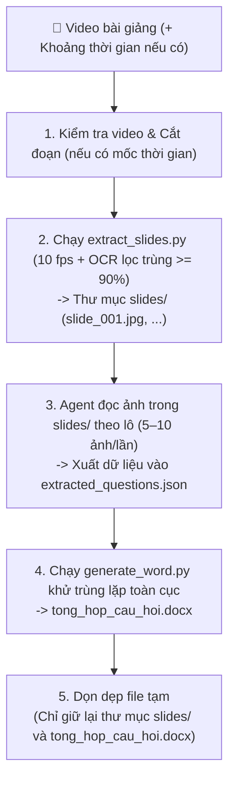

# 🎓 azotaFromVideo (V2.0) — Trích Xuất Đề Thi Trắc Nghiệm Từ Video Bài Giảng

> **Skill thông minh dành cho AI Agent (Antigravity):** Tự động trích xuất đề trắc nghiệm, hình ảnh minh họa, bảng biểu và đáp án từ video bài giảng bằng phương pháp **lấy mẫu 10 fps + lọc trùng OCR cục bộ ($\ge 90\%$)** — tiết kiệm 80–95% token AI, loại bỏ hoàn toàn quá tải ngữ cảnh và hallucination, tự động xuất file Word chuẩn format và dọn dẹp sạch sẽ.

---

## 🚀 Hướng Dẫn Cài Đặt (Quick Start)

> [!IMPORTANT]
> **Cách cài đặt nhanh nhất bằng AI Agent:**
> 1. Tải hoặc clone thư mục **`azotaFromVideo`** về máy tính của bạn.
> 2. Mở khung chat với **Agent (Antigravity)** trong thư mục dự án và gửi tin nhắn yêu cầu Agent cài đặt:
>    ```text
>    "Hãy cài đặt skill azotaFromVideo này giúp tôi"
>    ```
>    *(Agent sẽ tự động nhận diện file `SKILL.md` và tích hợp skill vào hệ thống của bạn).*

<details>
<summary><b>🛠️ Dành cho người muốn cài đặt thủ công (Click để mở rộng)</b></summary>

### Cách 1: Thiết lập cho riêng Dự án / Thư mục làm việc (Workspace Skill)
Copy thư mục `azotaFromVideo` vào thư mục dự án theo cấu trúc:
```text
your-project/
└── .agents/
    └── skills/
        └── azotaFromVideo/
            ├── SKILL.md
            ├── TOOL.md
            ├── README.md
            └── scripts/
```

### Cách 2: Thiết lập Toàn hệ thống (Global Skill)
Để có thể gọi lệnh `/azotaFromVideo` ở bất kỳ thư mục nào trên máy tính, copy toàn bộ thư mục `azotaFromVideo` vào:
- **Windows:** `C:\Users\<Tên_User>\.gemini\config\skills\azotaFromVideo\`
- **Linux / macOS:** `~/.gemini/config/skills/azotaFromVideo/`

### Cài đặt thư viện phụ trợ:
Đảm bảo máy tính đã cài đặt Python (>= 3.9) và cài đặt các thư viện hỗ trợ (không cần cài riêng FFmpeg vì đã tích hợp sẵn qua `imageio-ffmpeg`; trên Windows có sẵn `winocr` nên không cần cài thêm phần mềm OCR ngoài):
```bash
py -m pip install imageio-ffmpeg python-docx pillow numpy rapidfuzz
```
</details>

---

## 🌟 Điểm Nổi Bật & Tính Năng Vượt Trội (V2.0)

- ⚡ **Cắt video siêu tốc (Lossless):** Sử dụng FFmpeg stream copy (`-c copy`) khi cần cắt theo mốc thời gian, bảo toàn 100% độ sắc nét của chữ và hình ảnh trên slide.
- 🎯 **Lấy mẫu 10 fps (0.1s/frame) & Lọc trùng OCR $\ge 90\%$ cục bộ (0 tốn token AI):**
  - Tự động quét video ở tốc độ 10 fps để không bỏ sót câu hỏi lướt nhanh (0.5–1s).
  - Lọc frame tĩnh siêu nhanh bằng pixel-diff rồi chạy OCR cục bộ so sánh độ giống nhau của chữ ($\ge 90\%$ thì gộp, mặc định **giữ frame cuối cùng** để bắt trọn trạng thái đã hiện đáp án).
  - Không lọc bỏ các câu hỏi ngắn (câu cho điểm).
- 🧠 **Agent đọc ảnh theo lô (5–10 ảnh/lần):** Thay vì phải xem hàng trăm video chunk, Agent chỉ đọc các ảnh slide duy nhất đã lọc sạch $\rightarrow$ vừa giảm mạnh chi phí token, vừa giữ nguyên độ chính xác Vision.
- 🖼️ **Bóc tách ghi chú, Speaker Notes & hình ảnh minh họa:** Nhận diện cả đáp án đánh dấu trên slide chính lẫn vùng **Speaker Notes** phía dưới, đồng thời giữ đầy đủ hình ảnh minh họa / sơ đồ / bảng biểu.
- 🧹 **Khử trùng lặp toàn cục & Dọn dẹp gọn gàng:** Xuất một file `tong_hop_cau_hoi.docx` duy nhất (đáp án đúng tô **màu đỏ** và **in đậm**), tự động xóa mọi file tạm, chỉ giữ lại `slides/` và `tong_hop_cau_hoi.docx`.

---

## 🔄 Quy Trình Xử Lý Chuẩn 5 Bước (V2.0)



---

## 💻 Hướng Dẫn Sử Dụng

### Cách 1: Sử dụng Slash Command trong khung chat AI (Khuyên dùng)
Chỉ cần nhập lệnh bắt đầu bằng `/azotaFromVideo` kèm tên video, mốc thời gian (nếu cần cắt đoạn) và **ghi chú bổ sung** (nếu có):

```text
/azotaFromVideo
```
*(Video bắt buộc phải đặt **ngoài cùng của thư mục dự án**, không nằm bên ngoài hay trong thư mục con. Nếu có đúng 1 video, Agent tự động chạy; nếu có nhiều video hoặc không có video nào, Agent sẽ dừng lại nhắc bạn chỉ định tên video / đặt video đúng vị trí).*

```text
/azotaFromVideo từ 00:00:00 đến 00:02:15 DBI_P2.mp4
```
hoặc kèm ghi chú riêng để Agent xử lý chính xác hơn (ví dụ cách giáo viên đánh dấu đáp án, câu chọn nhiều đáp án...):
```text
/azotaFromVideo DBI_P2.mp4 ghi chú: đáp án đúng được giáo viên đánh dấu * hoặc tô màu, mặc định 1 đáp án
```

### Cách 2: Gọi Tool Trực Tiếp Bằng CLI (Dành cho Developer)
```bash
# 1. (Tùy chọn) Cắt đoạn video theo mốc thời gian
py scripts/cut_video.py -s 00:00:00 -e 1p14 -i DBI_P2.mp4

# 2. Trích xuất các ảnh slide duy nhất (10 fps + lọc trùng OCR >= 90%)
py scripts/extract_slides.py -i DBI_P2.mp4 -o slides

# 3. Xuất file Word từ JSON câu hỏi (tự động khử trùng lặp & tô đỏ đáp án đúng)
py scripts/generate_word.py -i extracted_questions.json -o tong_hop_cau_hoi.docx
```
*(Xem hướng dẫn chi tiết các tham số tại [TOOL.md](TOOL.md))*

---

## 📁 Cấu Trúc Kết Quả Sau Khi Hoàn Thành

Sau khi xử lý xong và dọn dẹp file trung gian, thư mục làm việc của bạn chỉ còn:

```text
📁 Thu_Muc_Lam_Viec/
├── 📁 slides/                         # Thư mục chứa các ảnh slide duy nhất để đối soát
│   ├── slide_001.jpg
│   ├── slide_002.jpg
│   ├── ...
│   └── slides_index.json              # Bảng chỉ mục timestamp & OCR preview
└── 📄 tong_hop_cau_hoi.docx           # File Word TỔNG HỢP DUY NHẤT chuẩn format
```

---

## 📝 Quy Chuẩn Định Dạng File Word Đầu Ra

File Word được thiết kế tương thích hoàn hảo để import vào hệ thống thi trực tuyến (như Azota, Quizizz, Google Forms...):

```text
Câu 1: Cho đoạn mã sau, giá trị in ra màn hình là bao nhiêu?
[Hình ảnh minh họa sơ đồ / đoạn code được chèn trực tiếp tại đây]
A. 10
B. 20 (chữ màu đỏ, in đậm)
C. 30
D. 40

Câu 2: Đâu là đặc điểm chính của mô hình kiến trúc Client-Server?
A. Phân chia vai trò rõ ràng giữa bên yêu cầu và bên phục vụ (chữ màu đỏ, in đậm)
B. Không cần máy chủ trung tâm
C. Mọi máy trạm đều có quyền hạn ngang nhau
D. Không hỗ trợ giao thức TCP/IP
```

---

## 📂 Cấu Trúc Mã Nguồn Dự Án

```text
azotaFromVideo/
├── SKILL.md            # Chỉ dẫn Prompt hệ thống (V2.0) cho AI Agent
├── README.md           # Tài liệu hướng dẫn sử dụng & giới thiệu dự án
├── TOOL.md             # Sổ tay chi tiết hướng dẫn các script dòng lệnh
└── scripts/            # Bộ mã nguồn thực thi
    ├── cut_video.py         # Cắt video siêu tốc không suy giảm chất lượng (Lossless)
    ├── extract_slides.py    # (V2.0) Lấy mẫu 10 fps + lọc pixel + OCR khử trùng >= 90%
    ├── generate_word.py     # Lọc trùng lặp toàn cục & xuất file Word chuẩn màu đáp án
    ├── split_chunks.py      # (V1.0 - legacy) Chia nhỏ video thành chunk <= 5s
    ├── extract_questions.py # (V1.0 - legacy) Khung sườn quét slide theo chunk
    └── pipeline.py          # (V1.0 - legacy) Script chuẩn bị chunk liên hoàn
```
