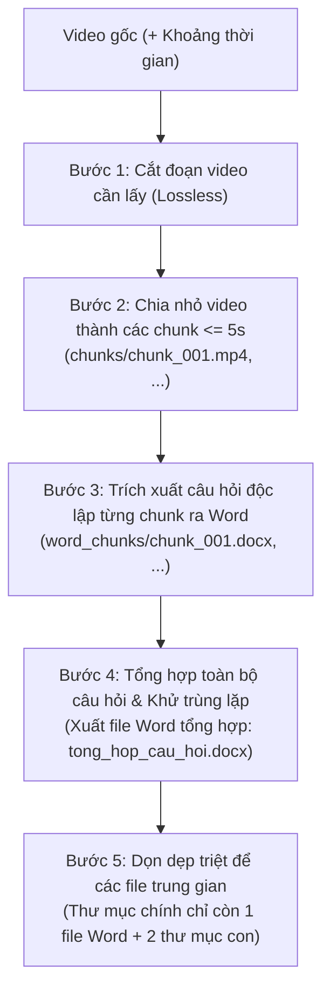

# Skill: azotaFromVideo

Skill này xử lý video trình chiếu câu hỏi trắc nghiệm (Google Slides, PowerPoint, PDF...) bằng chiến lược **chia nhỏ video (chunking)** để giảm tải nhận thức, đảm bảo AI không bị hallucination (ảo giác/bịa nội dung) hoặc bỏ sót câu hỏi khi xử lý video dài.

---

## Cú pháp kích hoạt

Người dùng có thể gọi skill theo các dạng:
- `/azotaFromVideo [khoảng thời gian] [tên video nếu có]`
- Ví dụ:
  - `/azotaFromVideo từ đầu đến 1p14`
  - `/azotaFromVideo 0s đến 74s DBI_P2.mp4`
  - `/azotaFromVideo 00:00:00 đến 00:02:30`
  - `/azotaFromVideo 1p14`

---

## Quy trình xử lý chuẩn 5 bước (Chia nhỏ, Trích xuất, Tổng hợp & Dọn dẹp)



---

### Bước 1: Nhận diện Video & Cắt đoạn thời gian yêu cầu
1. **Tìm video:**
   - Nếu người dùng chỉ định tên video: dùng file đó.
   - Nếu không chỉ định: tự động quét thư mục hiện tại để lấy file video (`.mp4`, `.mkv`, `.avi`, `.mov`, `.webm`).
2. **Cắt đoạn yêu cầu (Lossless):**
   - Chuyển đổi mốc thời gian người dùng nhập (`1p14`, `1m14s`, `74s`) sang chuẩn `HH:MM:SS` (ví dụ: `00:01:14`).
   - Sử dụng FFmpeg với `-c copy` để cắt tức thì, giữ nguyên chất lượng gốc tuyệt đối:
     ```bash
     ffmpeg -ss [start] -to [end] -i [input] -c copy [name]_cut.mp4 -y
     ```

---

### Bước 2: Chia nhỏ video thành các chunk vi mô (Tối đa 5 giây/chunk)
> **Mục đích:** Việc chia nhỏ video thành các đoạn ngắn $\le 5$ giây (mỗi đoạn chỉ chứa khoảng 1–5 câu hỏi) là bước bắt buộc để chia nhỏ bài toán, đảm bảo AI xử lý chính xác từng khung hình và không bị quá tải bộ nhớ ngữ cảnh.

1. Tạo thư mục con `chunks/` (chứa các video chunks).
2. Dùng FFmpeg ép keyframe cố định và cắt video thành các file `chunks/chunk_001.mp4`, `chunks/chunk_002.mp4`,...
   ```bash
   ffmpeg -y -i [video_cut] -c:v libx264 -crf 17 -preset fast -force_key_frames "expr:gte(t,n_forced*5)" -c:a aac -b:a 128k -f segment -segment_time 5 -segment_start_number 1 -reset_timestamps 1 chunks/chunk_%03d.mp4
   ```

---

### Bước 3: Xử lý và trích xuất câu hỏi độc lập cho từng chunk
1. **Xử lý tuần tự từng chunk:**
   - Duyệt qua từng file `chunks/chunk_XXX.mp4`.
   - Quét khung hình trong chunk để nhận diện các slide xuất hiện trong đoạn 5s đó.
   - Nhận diện chính xác:
     - **Nội dung câu hỏi**.
     - **Ghi chú cho câu hỏi**: Là các thông tin phụ được cho để phục vụ cho việc trả lời câu hỏi (ví dụ: hình ảnh minh hoạ, sơ đồ, bảng biểu, đoạn mã lệnh, hoặc ngữ cảnh câu hỏi). Nếu có hình ảnh minh hoạ trong slide, trích xuất ảnh sắc nét và chèn trực tiếp ngay dưới nội dung câu hỏi trong file Word.
     - **Các lựa chọn đáp án** (A, B, C, D, E).
     - **Đáp án đúng** (dựa vào ký hiệu đánh dấu, màu sắc đáp án trên slide hoặc vùng Speaker Notes; kèm lời giải thích nếu có).
   - Tự động bỏ qua các slide tiêu đề/chuyển mục không chứa câu hỏi.
2. **Đóng gói file Word theo từng chunk:**
   - Tạo thư mục con `word_chunks/`.
   - Lưu kết quả trích xuất của từng chunk thành file Word độc lập tương ứng bên trong thư mục này: `word_chunks/chunk_001.docx`, `word_chunks/chunk_002.docx`,... để dễ kiểm tra chéo và đối soát khi cần.

---

### Bước 4: Tổng hợp toàn bộ câu hỏi & Khử trùng lặp ra file Word duy nhất
1. **Thuật toán khử trùng lặp thông minh:**
   - **Lọc trùng do giao biên chunk:** Do chia đoạn cố định 5s, những slide nằm ở ranh giới 5s sẽ xuất hiện ở cả cuối chunk trước và đầu chunk sau $\rightarrow$ Tự động đối chiếu và chỉ giữ lại 1 lần duy nhất.
   - **Lọc trùng lặp nội dung bài giảng:** Nếu trong bài giảng có các slide trùng lặp câu hỏi (ví dụ giảng viên quay lại slide trước đó hoặc slide bị lặp) $\rightarrow$ Gộp thành một câu và giữ lại đầy đủ ghi chú/hình ảnh minh họa đầy đủ nhất.
2. **Xuất MỘT file Word tổng hợp duy nhất tại thư mục chính:**
   - Tên file: **`tong_hop_cau_hoi.docx`** (hoặc `de_thi_trac_nghiem.docx`).
   - Đánh số thứ tự lại liên tục từ Câu 1 đến câu cuối cùng.
3. **Quy chuẩn format bắt buộc trong file Word:**
   ```text
   Câu [số]: [Nội dung câu hỏi]
   [Ghi chú cho câu hỏi: hình ảnh minh họa / sơ đồ / bảng biểu / thông tin phụ phục vụ trả lời nếu có]
   A. [Nội dung đáp án A]
   B. [Nội dung đáp án B]
   C. [Nội dung đáp án C]
   D. [Nội dung đáp án D]
   ```
   - Mỗi câu hỏi có tiêu đề in đậm: `Câu 1:`, `Câu 2:`,...
   - Ghi chú phụ (hình ảnh minh họa, bảng biểu, dữ liệu đầu vào) đặt ngay dưới câu hỏi và trước các đáp án lựa chọn.
   - Mỗi phương án đáp án nằm trên **một dòng riêng biệt**.
   - **Đáp án đúng** bắt buộc được tô **màu chữ đỏ (`RGBColor(255, 0, 0)`)** và **in đậm**.
   - Các đáp án khác để chữ màu đen tiêu chuẩn.

---

### Bước 5: Dọn dẹp sạch sẽ các file & tool trung gian (Bắt buộc)
Sau khi file Word tổng hợp được tạo thành công, tiến hành dọn dẹp theo đúng tiêu chuẩn:
1. **Xoá sạch toàn bộ các file trung gian và tool phụ:**
   - Xoá video cắt tạm: `*_cut.mp4`.
   - Xoá các frame ảnh tạm (nếu sinh ra trong quá trình OCR/scan).
   - Xoá file danh sách nối, kịch bản batch tạm: `concat_list.txt`, `ghep_lai_video.bat`,...
   - Xoá các file dữ liệu trung gian: file JSON câu hỏi tạm (`extracted_questions.json`), log tạm, hoặc các script/tool tạo ra dùng tạm trong quá trình thực thi.
2. **Cấu trúc thư mục cuối cùng chỉ giữ lại đúng:**
   - Thư mục chính chỉ gồm:
     - 📁 **`chunks/`**: Thư mục con chứa các file video chunk (`chunk_001.mp4`, `chunk_002.mp4`,...).
     - 📁 **`word_chunks/`**: Thư mục con chứa các file Word của từng chunk (`chunk_001.docx`, `chunk_002.docx`,...).
     - 📄 **`tong_hop_cau_hoi.docx`**: File Word tổng hợp cuối cùng duy nhất nằm ở thư mục chính.

---

## Danh mục công cụ & Thư viện sử dụng
- **FFmpeg / imageio-ffmpeg:** Cắt video và chia chunk vi mô.
- **Python-docx:** Soạn thảo, chèn hình ảnh minh hoạ và định dạng màu chữ trong file Word `.docx`.
- **Pillow & Computer Vision / OCR:** Trích xuất khung hình, cắt ảnh minh hoạ và nhận diện văn bản slide.
