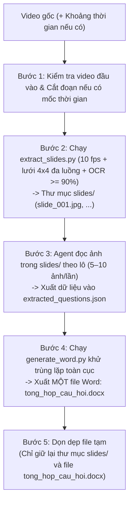

# Skill: azotaFromVideo (V2.1)

Skill này xử lý video trình chiếu câu hỏi trắc nghiệm (Google Slides, PowerPoint, PDF...) theo kiến trúc **Lọc cục bộ trước – AI đọc ảnh sau**:
- **Tool Python** lo toàn bộ việc lấy mẫu 0.1s/frame, lọc khung hình tĩnh và khử trùng lặp text $\ge 90\%$.
- **Agent** chỉ đọc tập ảnh slide duy nhất đã lọc sạch để trích xuất chính xác câu hỏi, hình minh họa và đáp án.

---

## Cú pháp kích hoạt & Nhận biết Ghi chú từ User

- `/azotaFromVideo [khoảng thời gian nếu có] [tên video nếu có] [ghi chú bổ sung nếu có]`
- Ví dụ:
  - `/azotaFromVideo` (xử lý toàn bộ video nếu thư mục chỉ có duy nhất 1 file video)
  - `/azotaFromVideo từ đầu đến 1p14`
  - `/azotaFromVideo 0s đến 74s DBI_P2.mp4`
  - `/azotaFromVideo DBI_P2.mp4 ghi chú: đáp án đúng GV đánh dấu sao *, có câu chọn 2 đáp án`
- **Nhận biết ghi chú của User:** Mọi phần văn bản ngoài **mốc thời gian** và **tên video** trong câu lệnh (ví dụ hướng dẫn cách GV đánh dấu đáp án, quy ước chọn nhiều đáp án, phạm vi câu hỏi...) đều là **ghi chú chỉ dẫn của người dùng**. Agent phải đọc kỹ và **ưu tiên tuân theo** các ghi chú này xuyên suốt Bước 1–4.

---

## Quy trình xử lý chuẩn 5 bước (V2.1)



---

### Bước 1: Kiểm tra Video & Cắt đoạn thời gian (Nếu có yêu cầu)
1. **Xác định video đầu vào (chỉ quét ở thư mục gốc của dự án):**
   - Video bắt buộc phải nằm **ngoài cùng của thư mục dự án** (thư mục làm việc hiện tại), **không** nằm bên ngoài dự án và **không** nằm trong các thư mục con.
   - Nếu người dùng chỉ định tên video: kiểm tra xem file đó có tồn tại ngay tại thư mục gốc dự án không; nếu không thấy $\rightarrow$ dừng lại và nhắc người dùng đặt video đúng vào thư mục gốc dự án.
   - Nếu người dùng **không** chỉ định tên video: chỉ quét các file video (`.mp4`, `.mkv`, `.avi`, `.mov`, `.webm`) ngay tại **thư mục gốc dự án** (không quét đệ quy vào thư mục con):
     - **Chỉ có đúng 1 file video:** tự động dùng file đó.
     - **Có từ 2 file video trở lên:** **DỪNG LẠI NGAY, không chạy bất kỳ tool nào** và yêu cầu người dùng gọi lại skill kèm **tên đầy đủ của video** cần xử lý hoặc xóa bớt các video dư thừa trong thư mục.
     - **Không có file video nào ở thư mục gốc:** **DỪNG LẠI NGAY, không chạy bất kỳ tool nào** và nhắc người dùng đặt file video vào **ngoài cùng của thư mục dự án** (không để bên ngoài dự án hay trong thư mục con), sau đó gọi lại skill.
2. **Cắt đoạn (chỉ chạy khi người dùng chỉ định khoảng thời gian):**
   ```bash
   py scripts/cut_video.py -s [start] -e [end] -i [input] -o video_cut.mp4
   ```
   Nếu không chỉ định khoảng thời gian $\rightarrow$ bỏ qua bước này, dùng trực tiếp file video gốc cho Bước 2.

---

### Bước 2: Trích xuất ảnh slide duy nhất bằng Tool cục bộ (Không tốn token AI)
Chạy tool `extract_slides.py` để lấy mẫu ở **10 fps (0.1s/frame)**, lọc frame đứng yên song song trên `2/3` số luồng CPU (ảnh `256x144`, chia lưới `4x4` chống bỏ sót chữ ngắn trên nền trắng + gộp điểm nối giữa các luồng) và gộp các frame trùng nội dung chữ $\ge 90\%$ (ưu tiên giữ frame cuối để bắt trọn trạng thái đã hiện đáp án):
```bash
py scripts/extract_slides.py -i [video_input] -o slides
```
Kết quả thu được thư mục `slides/` chứa `slide_001.jpg`, `slide_002.jpg`,... và `slides/slides_index.json`.

---

### Bước 3: Agent đọc ảnh theo lô & Trích xuất câu hỏi ra JSON
1. **Đọc ảnh theo lô nhỏ (Batching):**
   - Duyệt tuần tự các file `slides/slide_XXX.jpg`, mỗi lần đọc **5–10 ảnh** để đảm bảo độ chính xác cao, không quá tải ngữ cảnh và không bị hallucination.
   - **Số lượng câu hỏi trong 1 ảnh là linh hoạt (`0, 1, 2, 3, ...`):** Không mặc định mỗi ảnh phải có đúng 1 câu hỏi:
     - **0 câu hỏi:** Nếu ảnh là quá trình chuyển tab, màn hình desktop/ứng dụng khác, slide tiêu đề, hoặc dữ liệu tạp/nhiễu $\rightarrow$ **bỏ qua**, không cố bịa câu hỏi.
     - **Nhiều câu hỏi (`2, 3, ...`):** Nếu trên cùng một ảnh/trang hiển thị nhiều câu hỏi cùng lúc $\rightarrow$ bóc tách đầy đủ từng câu hỏi thành các mục riêng biệt.
   - Tuyệt đối **không** tự ý bỏ qua các câu hỏi ngắn (câu cho điểm).
2. **Quy tắc nhận diện nội dung & đáp án từ ảnh:**
   - **Nội dung câu hỏi:** Giữ chính xác nội dung câu hỏi.
   - **Ghi chú / Hình ảnh minh họa:** Nếu slide có sơ đồ, bảng biểu, đoạn mã hoặc hình minh họa phục vụ trả lời, cắt vùng ảnh đó từ `slide_XXX.jpg` lưu vào `_cropped_imgs/` (hoặc ghi chú vào trường `extra`).
   - **Các lựa chọn đáp án:** Đầy đủ `A`, `B`, `C`, `D` (và `E` nếu có).
   - **Quy tắc xác định đáp án đúng (Bắt buộc):**
     1. **Ưu tiên tuyệt đối đáp án của giáo viên / tài liệu:** Kiểm tra kỹ cả **trên slide chính** (tô màu chữ/nền khác, in đậm, đánh dấu sao `*`, gạch chân, khoanh tròn, dấu tích...) lẫn **vùng Speaker Notes phía dưới** (ví dụ `D`, `E` ở góc dưới Google Slides) và **ghi chú của user**. Nếu đã có dấu hiệu đáp án từ giáo viên $\rightarrow$ **bắt buộc dùng đúng đáp án đó**, không tự ý sửa.
     2. **Khi không có đáp án sẵn:** Chỉ khi slide/Speaker Notes hoàn toàn không đánh dấu đáp án thì Agent mới tự giải để chọn đáp án đúng.
     3. **Số lượng đáp án đúng:** **Mặc định là câu hỏi 1 đáp án** (`"correct": ["B"]`), trừ khi đề bài (ví dụ *"Choose 2 answers"*), giáo viên (đánh dấu nhiều đáp án), hoặc ghi chú của user yêu cầu chọn nhiều đáp án.
3. **Lưu dữ liệu:** Tổng hợp toàn bộ câu hỏi đã trích xuất vào file `extracted_questions.json` theo đúng cấu trúc chuẩn của `generate_word.py`:
   ```json
   [
     {
       "question": "Nội dung câu hỏi...",
       "extra": "Ghi chú / dữ liệu phụ nếu có",
       "image": "_cropped_imgs/slide_005_crop.jpg",
       "slides": [5],
       "options": [
         ["A", "Nội dung đáp án A"],
         ["B", "Nội dung đáp án B"],
         ["C", "Nội dung đáp án C"],
         ["D", "Nội dung đáp án D"]
       ],
       "correct": ["B"]
     }
   ]
   ```
   *(Các trường `extra`, `image`, `slides` có thể bỏ qua nếu không có).*

---

### Bước 4: Khử trùng lặp toàn cục & Xuất file Word duy nhất
Chạy tool `generate_word.py` để lọc nốt các câu trùng lặp không liên tiếp (ví dụ giảng viên lật lại slide cũ) và xuất file Word chuẩn format:
```bash
py scripts/generate_word.py -i extracted_questions.json -o tong_hop_cau_hoi.docx
```
**Quy chuẩn format bắt buộc trong `tong_hop_cau_hoi.docx`:**
- Mỗi câu hỏi bắt đầu bằng **`Câu [số]:`** (in đậm).
- Ghi chú phụ / hình ảnh minh họa (nếu có) đặt ngay dưới câu hỏi, trước các đáp án.
- Mỗi đáp án `A.`, `B.`, `C.`, `D.`... nằm trên **một dòng riêng biệt**.
- **Đáp án đúng:** bắt buộc tô **màu đỏ (`RGBColor(255, 0, 0)`)** và **in đậm**.

---

### Bước 5: Dọn dẹp file trung gian
Sau khi `tong_hop_cau_hoi.docx` đã tạo thành công:
1. Xóa các file/thư mục tạm: `video_cut.mp4` (`*_cut.mp4`), `_tmp_frames/`, `_cropped_imgs/`, `extracted_questions.json`, các script tạm (nếu có).
2. **Thư mục chính cuối cùng chỉ giữ lại:**
   - 📁 **`slides/`**: Chứa các ảnh slide câu hỏi duy nhất + `slides_index.json` để người dùng đối soát khi cần.
   - 📄 **`tong_hop_cau_hoi.docx`**: File Word kết quả cuối cùng.

---

## Danh mục công cụ & Thư viện sử dụng
- **FFmpeg / imageio-ffmpeg:** Cắt video và lấy mẫu frame 10 fps.
- **Pillow, NumPy, RapidFuzz & OCR (`rapidocr` / `tesseract` / `winocr`):** Lọc frame tĩnh và khử trùng lặp văn bản $\ge 90\%$ cục bộ.
- **Python-docx:** Soạn thảo, chèn hình ảnh minh hoạ và định dạng màu chữ trong file Word `.docx`.
